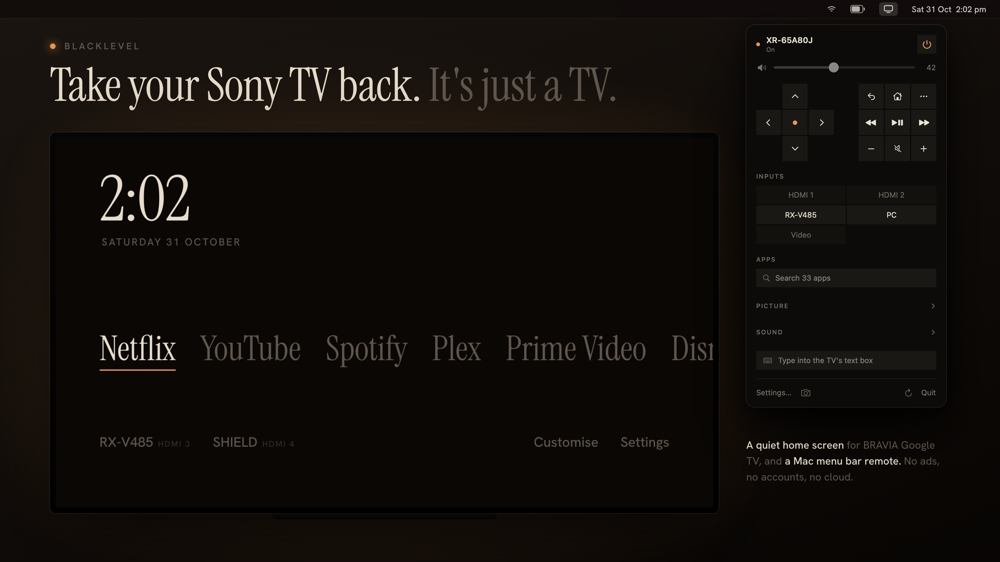
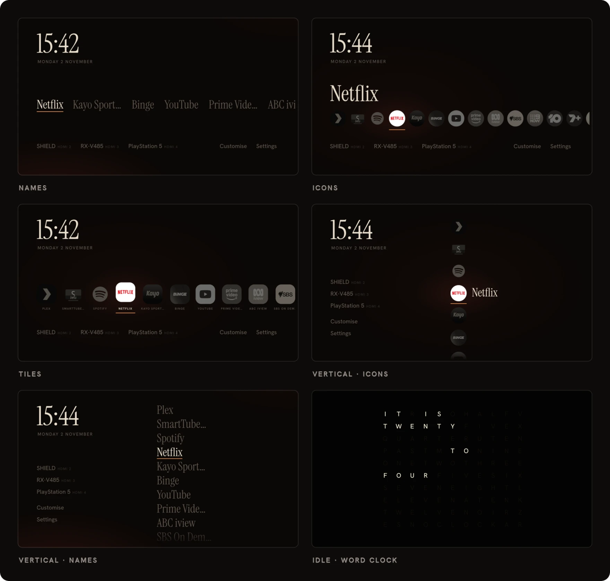
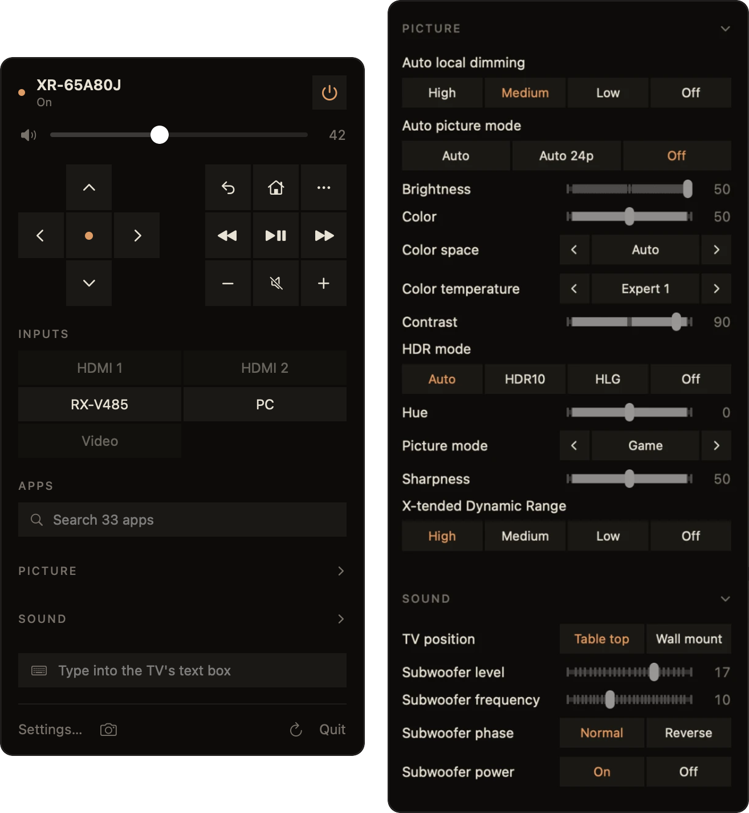

# Blacklevel

**Take your Sony TV back. It's just a TV.**

Blacklevel replaces the busy parts of a Sony BRAVIA Google TV with quiet ones: a dark, typographic home screen with no ads or recommendation rows, and a native macOS menu bar remote. No accounts, no cloud, no third-party code. Everything talks to the TV over your local network. The only internet service either app contacts is GitHub, to check this repo's Releases for updates, which you can turn off. [What talks to what](#what-talks-to-what) has the details.

<p align="center">
  
</p>

## What's in the box

| | Runs on | What it is |
|---|---|---|
| **[Blacklevel Home](launcher/)** | The TV (Android TV / Google TV) | A replacement home screen. The time, one row of your apps, one row of your HDMI inputs, and Settings. Nothing else. Built for OLED: dark, dims when idle, drifts to avoid burn-in. ~150 KB. |
| **[Blacklevel Remote](menubar/)** | macOS 14+ | A SwiftUI menu bar remote: power, volume, inputs, apps, D-pad, playback, picture and sound settings, text entry, screenshots. Uses Sony's BRAVIA REST API and IRCC codes. |

<p align="center">
  
</p>

<p align="center">
  
</p>

## Quick start

1. **Prepare the TV**: turn on IP control with a pre-shared key, and (for Home) network debugging. See [TV setup](docs/tv-setup.md).
2. **Remote**: download `BlacklevelRemote-<version>-macOS.zip` from [Releases](https://github.com/itsonlyjames/blacklevel/releases/latest), move the app to Applications and open it (it's signed and notarised), then enter the TV's address and key in **Settings…**. Or build it: `cd menubar && ./build.sh`. [More](menubar/README.md)
3. **Home**: download `BlacklevelHome-<version>.apk` from [Releases](https://github.com/itsonlyjames/blacklevel/releases/latest) (or `cd launcher && ./build.sh`), then install and set it as the home screen with `adb`. [More](launcher/README.md)

Both parts are independent. Use either, or both.

To check a download yourself, put it next to the release's `SHA256SUMS.txt` and run `shasum -a 256 -c SHA256SUMS.txt --ignore-missing`; for the Mac app, `spctl -a -vv /Applications/BlacklevelRemote.app` should say it's accepted and notarised.

---

<a name="prompt-your-agent"></a>
<p align="center">
  
</p>

Rather not do this by hand? Copy a prompt into a coding agent that can run commands on your Mac (Claude Code, Codex, Cursor and the like). Each one tells the agent to explain what it's about to do and wait for your go-ahead before it changes your TV.

<details open>
<summary><b>Install the Remote on my Mac</b></summary>

```text
Install Blacklevel Remote from https://github.com/itsonlyjames/blacklevel on this Mac.
Read README.md and menubar/README.md first. Download the latest
BlacklevelRemote-<version>-macOS.zip from the repo's GitHub Releases, check it against
SHA256SUMS.txt from the same release, confirm the app is signed and notarised
(spctl -a -vv), then move it to /Applications and open it. Then walk me through
docs/tv-setup.md to turn on IP control and set a pre-shared key on the TV, and tell me
what to enter in the app's Settings. Ask me for anything you can't find out yourself.
```

</details>

<details>
<summary><b>Install Home on my TV</b></summary>

```text
Install Blacklevel Home from https://github.com/itsonlyjames/blacklevel on my Sony TV.
Read README.md, docs/tv-setup.md and launcher/README.md first. Help me turn on network
debugging, connect with adb (install it with Homebrew if it's missing), download the
latest BlacklevelHome-<version>.apk from GitHub Releases, check it against SHA256SUMS.txt,
and install it with the commands in the Install section. Before you disable any
Google TV packages, list each one, say what it does, show me how to undo it (the
"Revert to the stock home screen" section) and wait for me to say yes.
```

</details>

<details>
<summary><b>Is it safe?</b></summary>

```text
Review https://github.com/itsonlyjames/blacklevel before I install it, and give me a
plain-English verdict. Read the source, not just the README. Check: every network
request each app makes and where it goes (the README says GitHub's update check is the only
internet request); which Android permissions Home asks for and why; how the
Remote stores the TV's pre-shared key; what the install steps change on the TV and
whether launcher/README.md's revert steps undo all of it; and that the release
downloads match SHA256SUMS.txt. Flag anything that doesn't match what the README
claims.
```

</details>

<details>
<summary><b>Put my TV back to Google TV</b></summary>

```text
I installed Blacklevel Home (https://github.com/itsonlyjames/blacklevel) and want my
Sony TV's stock home screen back. Read the "Revert to the stock home screen" section
of launcher/README.md, connect to the TV with adb, show me the commands you'll run,
run them once I agree, then check that pressing Home opens Google TV again.
```

</details>

<details>
<summary><b>Something isn't working</b></summary>

```text
Blacklevel (https://github.com/itsonlyjames/blacklevel) isn't working for me: <describe
what happens>. Read docs/troubleshooting.md and the README for the part that's broken,
work out the likely cause, and run only read-only checks (adb devices, the Remote's
--selftest, and so on) until you've told me what you found and what you'd change.
```

</details>

---

## What talks to what

On the internet, the only service either app contacts is GitHub: the update check, and the download when you choose to update. Everything else stays on your local network.

| App | Talks to | How |
|---|---|---|
| Remote | The TV | Sony's BRAVIA REST API and IRCC over plain HTTP, with the pre-shared key in an `X-Auth-PSK` header ([why that matters](docs/tv-setup.md#2-ip-control-and-pre-shared-key-for-blacklevel-remote)) |
| Remote | Your network | SSDP multicast to find the TV; a Wake-on-LAN broadcast to wake it |
| Remote | The TV, optional | ADB on port 5555, for remote keys and screenshots, only if `adb` is installed and network debugging is on |
| Remote | GitHub | Shortly after it opens, then every 24 hours while it runs |
| Home | The TV itself | Sony's local API at `127.0.0.1`, without a key, for the names of HDMI-CEC devices |
| Home | GitHub | When the home screen opens or comes back to the front, if it hasn't checked in the last 24 hours |

Turn the update checks off with **Settings… → Updates** in the Remote and **Customise → Updates → Updates** on Home. Either updater checks the SHA-256 of the download against the release's `SHA256SUMS.txt` and refuses to install if that file is missing or doesn't match.

## Compatibility

Developed and tested on a **Sony XR-65A80J** (2021, Google TV). It should work on other BRAVIA TVs that expose the BRAVIA REST API ("IP control"), which covers most Sony Android TV and Google TV models from 2015 onward. The remote reads the TV's supported methods, inputs, apps and remote keys at runtime, so it only shows what your TV can do.

If you try it on another model, please open an issue with what worked and what didn't.

## Further intentions

Ideas, not promises. The rule stays the same: local network only, no accounts, no cloud, no third-party code.

- **Mobile remote**: an iPhone (and maybe Android) app with the same features as the menu bar remote, built on the same BRAVIA REST API and IRCC calls. A phone remote that does only what the TV needs, without the vendor app's sign-in and suggestions.
- **Windows tray remote**: the menu bar remote for Windows, living in the system tray. Same feature set, same "reads what your TV supports at runtime" approach.
- **Shared API layer**: as more clients appear, write down the BRAVIA calls each one depends on (methods, IRCC codes, quirks per model) so every client behaves the same way.
- **Wider model testing**: confirm behaviour beyond the XR-65A80J and note the differences in [Compatibility](#compatibility).

If one of these matters to you, open an issue and say so.

## Working with coding agents

This repo is small and dependency-free on purpose, which makes it easy to hand to a coding agent (Claude Code, Codex, Cursor and the like). Point the agent at this section, then at the README for the part it's changing.

**Orientation**

- `launcher/`: Blacklevel Home. Kotlin `HomeActivity.kt` hosts a WebView; the whole UI is `app/assets/index.html`. Built by `build.sh` with `kotlinc`, `d8` and `aapt2`; no Gradle. Design intent lives in `launcher/.impeccable.md`; read it before touching the UI.
- `menubar/`: Blacklevel Remote. A Swift package: `BraviaClient.swift` (REST + IRCC), `TVStore.swift` (state), `Views.swift` (SwiftUI), `Support.swift` (keychain, helpers), `SelfTest.swift`. Built by `build.sh`; no Xcode project.
- `docs/`: user-facing setup and troubleshooting. `docs/images/` holds the screenshots used in READMEs.

**Ground rules**

- No new dependencies, package managers, build systems or network services. Everything talks to the TV on the LAN. The one exception is the update check against GitHub Releases (`Updater.swift`, and `checkUpdate`/`installUpdate` in `HomeActivity.kt`); keep it the only one, and keep it switchable.
- Keep the launcher OLED-safe: dark backgrounds, no large static bright areas, keep the idle dimming and drift. D-pad navigation must keep working.
- Don't hard-code a model's capabilities. Ask the TV (supported methods, inputs, apps, remote keys) and hide what it doesn't support.
- Never commit secrets: the pre-shared key lives in the macOS keychain, `*.keystore` is ignored, and TV IPs belong in settings, not source.
- Match the surrounding code's style and comment density. Small, focused changes.

**Checking your work**

- Remote: `cd menubar && ./build.sh`, then `build/BlacklevelRemote.app/Contents/MacOS/BlacklevelRemote --selftest` to run every API call against a real TV (non-disruptive), and `--snapshot menu.png` to render the menu to an image for visual review.
- Home: `cd launcher && ./build.sh`, install with `adb`, and check it on the TV with a D-pad. `index.html` can also be opened in a desktop browser for layout work.
- If a change alters what the user sees, update the matching screenshot in `docs/images/` and the README that describes it.

## Documentation

- [TV setup](docs/tv-setup.md): IP control, pre-shared key, remote start, network debugging
- [Blacklevel Home](launcher/README.md): build, install, customise, revert
- [Blacklevel Remote](menubar/README.md): build, run, feature list
- [Troubleshooting](docs/troubleshooting.md)

## Building from source

No Gradle, no Xcode project, no dependencies to fetch.

- **Home** needs `openjdk@17`, `kotlin`, and Android SDK `platforms;android-34` + `build-tools;34.0.0`.
- **Remote** needs Swift 5.9+ (Xcode Command Line Tools) on macOS 14 or later.

## License

[MIT](LICENSE). The bundled fonts (Hanken Grotesk, Instrument Serif) are under the [SIL Open Font License](launcher/app/assets/fonts/OFL.txt).

Blacklevel is an independent project and is not affiliated with, endorsed by, or sponsored by Sony Group Corporation or Google LLC. Sony and BRAVIA are trademarks of Sony Group Corporation. Google TV and Android TV are trademarks of Google LLC.
