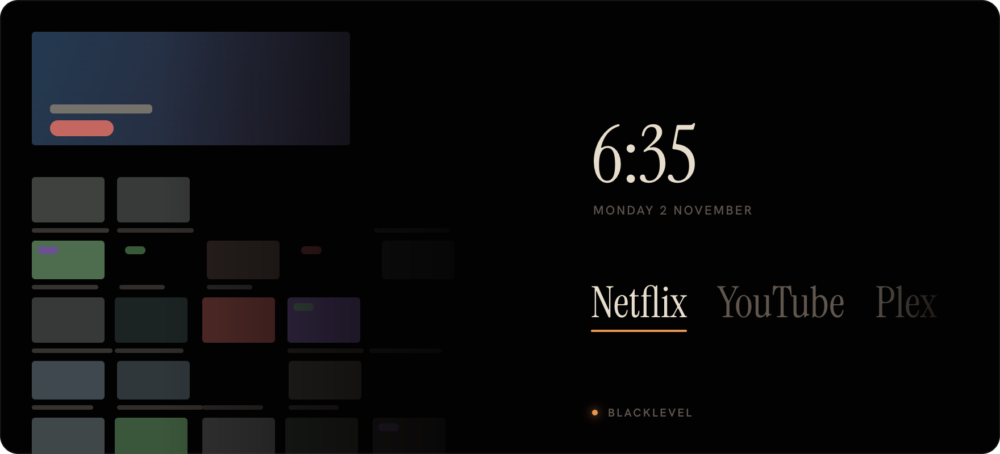
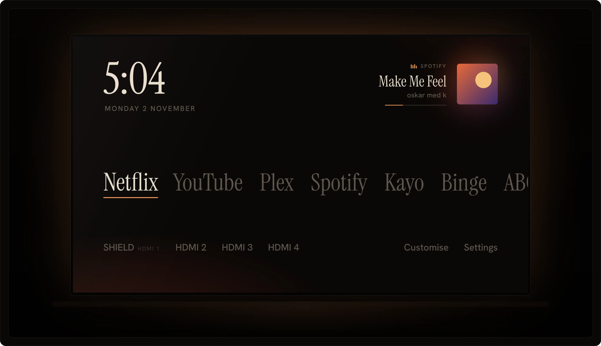
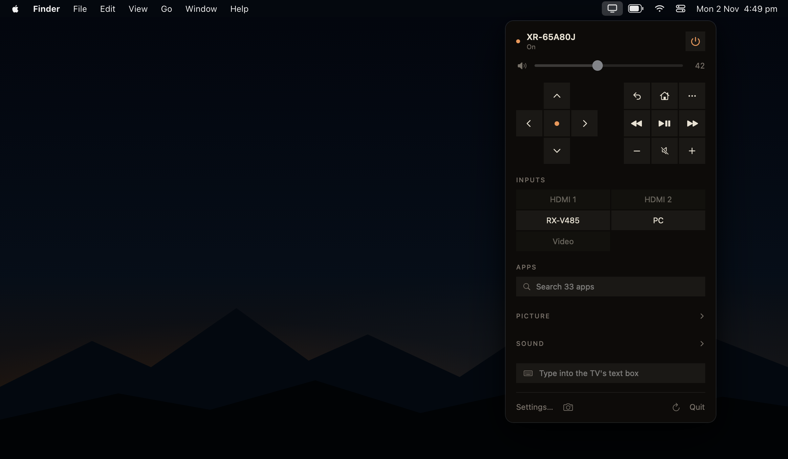

# Blacklevel

**Take your Sony TV back. It's just a TV.**

Blacklevel replaces the busy parts of a Sony BRAVIA Google TV with quiet ones: a dark, typographic home screen with no ads or recommendation rows, and a native macOS menu bar remote. No accounts, no cloud, no third-party code. Everything talks to the TV over your local network. The only internet service either app contacts is GitHub, to check this repo's Releases for updates, which you can turn off. [What talks to what](#what-talks-to-what) has the details.

<p align="center">
  
</p>

<br>

## Quick start

1. **Prepare the TV**: turn on IP control with a pre-shared key, and (for Home) network debugging. See [TV setup](docs/tv-setup.md).

2. **Remote**: download `BlacklevelRemote-<version>-macOS.zip` from [Releases](https://github.com/itsonlyjames/blacklevel/releases/latest), move the app to Applications and open it (it's signed and notarised), then enter the TV's address and key in **Settings…**. Or build it: `cd menubar && ./build.sh`. [More](menubar/README.md)

3. **Home**: download `BlacklevelHome-<version>.apk` from [Releases](https://github.com/itsonlyjames/blacklevel/releases/latest) (or `cd launcher && ./build.sh`), then install and set it as the home screen with `adb`. [More](launcher/README.md)

Both parts are independent. Use either, or both.

<a name="compatibility"></a>

Developed and tested on a **Sony XR-65A80J** (2021, Google TV), and should work on most BRAVIA Android TV and Google TV models from 2015 onward. Got a different BRAVIA? [Help test it](docs/compatibility.md).

<br>

## What's in the box

### [Blacklevel Home](launcher/)

A replacement home screen for the TV (Android TV / Google TV). The time, one row of your apps, one row of your HDMI inputs, and Settings. Nothing else. Built for OLED: dark, dims when idle, drifts to avoid burn-in. ~150 KB.

<p>
  
</p>

<br>

### [Blacklevel Remote](menubar/)

A SwiftUI menu bar remote for macOS 14+: power, volume, inputs, apps, D-pad, playback, picture and sound settings, text entry, screenshots. Uses Sony's BRAVIA REST API and IRCC codes.

<p>
  
</p>

<br>

---

<br>

<a name="prompt-your-agent"></a>
<p align="center">
  
</p>

Rather not do this by hand? Copy a prompt into a coding agent that can run commands on your Mac (Claude Code, Codex, Cursor and the like). Each one tells the agent to explain what it's about to do and wait for your go-ahead before it changes your TV.

<details>
<summary><b>Will this work on my TV?</b></summary>

```text
Will Blacklevel (https://github.com/itsonlyjames/blacklevel) work on my TV? It's a
<brand and model>. Read the "Will it work on my TV?" and "Reporting" sections of
docs/compatibility.md first, work out which row of the table my TV falls in, and use
https://cleanyour.tv/tvs to look up what it runs if you need to. Run only the read-only
checks on that page, and ask me before anything that needs me to change a setting on
the TV or install something on it. Then tell me plainly whether the Remote and Home
would work, partly work or not work, and why. If it's anything but a clean yes, or my
model isn't in the Tested table, draft a report with the fields in
.github/ISSUE_TEMPLATE/tv-report.yml: what worked, what didn't and the output of each
check. Remove IP and MAC addresses, serial numbers, keys, and network or account names.
Show me the whole draft and open the issue only after I've said yes.
```

</details>

<details open>
<summary><b>Install the Remote on my Mac</b></summary>

```text
Install Blacklevel Remote from https://github.com/itsonlyjames/blacklevel on this Mac.
Read README.md and menubar/README.md first. Download the latest
BlacklevelRemote-<version>-macOS.zip from the repo's GitHub Releases, check it against
SHA256SUMS.txt from the same release, confirm the app is signed and notarised
(spctl -a -vv), then move it to /Applications and open it. Then walk me through
docs/tv-setup.md to turn on IP control and set a pre-shared key on the TV, and tell me
what to enter in the app's Settings. Ask me for anything you can't find out yourself.
```

</details>

<details>
<summary><b>Install Home on my TV</b></summary>

```text
Install Blacklevel Home from https://github.com/itsonlyjames/blacklevel on my Sony TV.
Read README.md, docs/tv-setup.md and launcher/README.md first. Help me turn on network
debugging, connect with adb (install it with Homebrew if it's missing), download the
latest BlacklevelHome-<version>.apk from GitHub Releases, check it against SHA256SUMS.txt,
and install it with the commands in the Install section. Before you disable any
Google TV packages, list each one, say what it does, show me how to undo it (the
"Revert to the stock home screen" section) and wait for me to say yes.
```

</details>

<details>
<summary><b>Is it safe?</b></summary>

```text
Review https://github.com/itsonlyjames/blacklevel before I install it, and give me a
plain-English verdict. Read the source, not just the README. Check: every network
request each app makes and where it goes (the README says GitHub's update check is the only
internet request); which Android permissions Home asks for and why; how the
Remote stores the TV's pre-shared key; what the install steps change on the TV and
whether launcher/README.md's revert steps undo all of it; and that the release
downloads match SHA256SUMS.txt. Flag anything that doesn't match what the README
claims.
```

</details>

<details>
<summary><b>Put my TV back to Google TV</b></summary>

```text
I installed Blacklevel Home (https://github.com/itsonlyjames/blacklevel) and want my
Sony TV's stock home screen back. Read the "Revert to the stock home screen" section
of launcher/README.md, connect to the TV with adb, show me the commands you'll run,
run them once I agree, then check that pressing Home opens Google TV again.
```

</details>

<details>
<summary><b>Something isn't working</b></summary>

```text
Blacklevel (https://github.com/itsonlyjames/blacklevel) isn't working for me: <describe
what happens>. Read docs/troubleshooting.md and the README for the part that's broken,
work out the likely cause, and run only read-only checks (adb devices, the Remote's
--selftest, and so on) until you've told me what you found and what you'd change.
```

</details>

<br>

---

<br>

## What talks to what

On the internet, the only service either app contacts is GitHub: the update check, and the download when you choose to update. Everything else stays on your local network.

| App | Talks to | How |
|---|---|---|
| Remote | The TV | Sony's BRAVIA REST API and IRCC over plain HTTP, with the pre-shared key in an `X-Auth-PSK` header ([why that matters](docs/tv-setup.md#2-ip-control-and-pre-shared-key-for-blacklevel-remote)) |
| Remote | Your network | SSDP multicast to find the TV; a Wake-on-LAN broadcast to wake it |
| Remote | The TV, optional | ADB on port 5555, for remote keys and screenshots, only if `adb` is installed and network debugging is on |
| Remote | GitHub | Shortly after it opens, then every 24 hours while it runs |
| Home | The TV itself | Sony's local API at `127.0.0.1`, without a key, for the names of HDMI-CEC devices |
| Home | GitHub | When the home screen opens or comes back to the front, if it hasn't checked in the last 24 hours |

Turn the update checks off with **Settings… → Updates** in the Remote and **Customise → Updates → Updates** on Home. Either updater checks the SHA-256 of the download against the release's `SHA256SUMS.txt` and refuses to install if that file is missing or doesn't match.

<br>

## Verified releases

Every release is checkable, and none of it relies on taking this README's word for it:

- **Attested on GitHub.** From v1.4.0, a GitHub Actions workflow ([attest-release.yml](.github/workflows/attest-release.yml)) checks each release's files against `SHA256SUMS.txt` and signs a provenance attestation for them. They're listed on the repo's [Attestations](https://github.com/itsonlyjames/blacklevel/attestations) page; each one names the commit, the tag and the workflow run, and the SHA-256 of every file.

- **The APK is rebuilt from source.** From v1.4.1, a second workflow ([reproduce-apk.yml](.github/workflows/reproduce-apk.yml)) checks out the release's tag, builds Blacklevel Home on a GitHub runner with the same pinned toolchain, and compares it with the published APK. Only the signature may differ, and the published APK must carry the release certificate. When both hold, it attests the APK, so the attestation says it was built from that source.

- **Recorded in a public log.** Each attestation is also written to [Sigstore](https://www.sigstore.dev)'s public transparency log, which can't be edited afterwards, so a release can't be quietly re-attested later. The attestation's Actions run links to its log entry.

- **Signed by the maintainer.** In releases after 1.4.1, the tag and `SHA256SUMS.txt` are signed with the key in [docs/allowed_signers](docs/allowed_signers), and GitHub marks the tag as Verified.

- **Signed apps.** The Mac app is signed with a Developer ID and notarised by Apple; the APK is always signed with the same certificate, so Android only installs updates from it.

What this proves: the files are exactly the ones this repo's release published, and the APK was built from the tagged source.

What it doesn't: the Mac app is signed and notarised on the maintainer's Mac, and rebuilding it byte for byte depends on the exact Xcode version, so it isn't rebuilt in CI. Its Developer ID signature and Apple's notarisation tie it to the maintainer instead. Signing keys never leave that Mac, so a compromised workflow could at worst publish a misleading attestation, never a signed app or update.

### Check a download

Put the downloads in one folder and run:

```bash
shasum -a 256 -c SHA256SUMS.txt --ignore-missing
```

In releases after 1.4.1, `SHA256SUMS.txt` is signed with the release key in [docs/allowed_signers](docs/allowed_signers), so you can check the checksums came from the maintainer and not just from the release page:

```bash
curl -fsSLO https://raw.githubusercontent.com/itsonlyjames/blacklevel/main/docs/allowed_signers
ssh-keygen -Y verify -f allowed_signers -I blacklevel -n file -s SHA256SUMS.txt.sig < SHA256SUMS.txt
```

You can also check each part on its own:

- **Release tags** are signed with the same key. In a clone, from the same releases: `git -c gpg.ssh.allowedSignersFile=docs/allowed_signers tag -v <tag>`.

- **The APK** is signed with a certificate whose SHA-256 is `2b2bf7edf53bd0d90f68f0c7825a7e14bb3d2de113897b6e35c1ab02868fcdcc`; `apksigner verify --print-certs BlacklevelHome-<version>.apk` should show it.

- **The Mac app**: `spctl -a -vv /Applications/BlacklevelRemote.app` should say it's accepted and notarised.

From v1.4.0, each release's files also carry a GitHub attestation: with the [GitHub CLI](https://cli.github.com), run `gh attestation verify <file> --repo itsonlyjames/blacklevel`. To check the APK was rebuilt from source (from v1.4.1), add `--signer-workflow itsonlyjames/blacklevel/.github/workflows/reproduce-apk.yml`.

<br>

## Documentation

- [TV setup](docs/tv-setup.md): IP control, pre-shared key, remote start, network debugging
- [Blacklevel Home](launcher/README.md): build, install, customise, revert
- [Blacklevel Remote](menubar/README.md): build, run, feature list
- [Troubleshooting](docs/troubleshooting.md)
- [Compatibility](docs/compatibility.md): tested models, and how to test yours and report it
- **Changing the code, as an agent or a person?** Read [AGENTS.md](AGENTS.md) first: where things live, the ground rules, and how to check your work.

### Building from source

No Gradle, no Xcode project, no dependencies to fetch.

- **Home** needs `openjdk@17`, `kotlin`, and Android SDK `platforms;android-34` + `build-tools;34.0.0`.
- **Remote** needs Swift 5.9+ (Xcode Command Line Tools) on macOS 14 or later.

<br>

## Further intentions

Ideas, not promises. The rule stays the same: local network only, no accounts, no cloud, no third-party code.

- **Mobile remote**: an iPhone (and maybe Android) app with the same features as the menu bar remote, built on the same BRAVIA REST API and IRCC calls. A phone remote that does only what the TV needs, without the vendor app's sign-in and suggestions.

- **Windows tray remote**: the menu bar remote for Windows, living in the system tray. Same feature set, same "reads what your TV supports at runtime" approach.

- **Shared API layer**: as more clients appear, write down the BRAVIA calls each one depends on (methods, IRCC codes, quirks per model) so every client behaves the same way.

- **Wider model testing**: confirm behaviour beyond the XR-65A80J and note the differences in [docs/compatibility.md](docs/compatibility.md).

If one of these matters to you, open an issue and say so.

<br>

## License

[MIT](LICENSE). The bundled fonts (Hanken Grotesk, Instrument Serif) are under the [SIL Open Font License](launcher/app/assets/fonts/OFL.txt).

Blacklevel is an independent project and is not affiliated with, endorsed by, or sponsored by Sony Group Corporation or Google LLC. Sony and BRAVIA are trademarks of Sony Group Corporation. Google TV and Android TV are trademarks of Google LLC.
