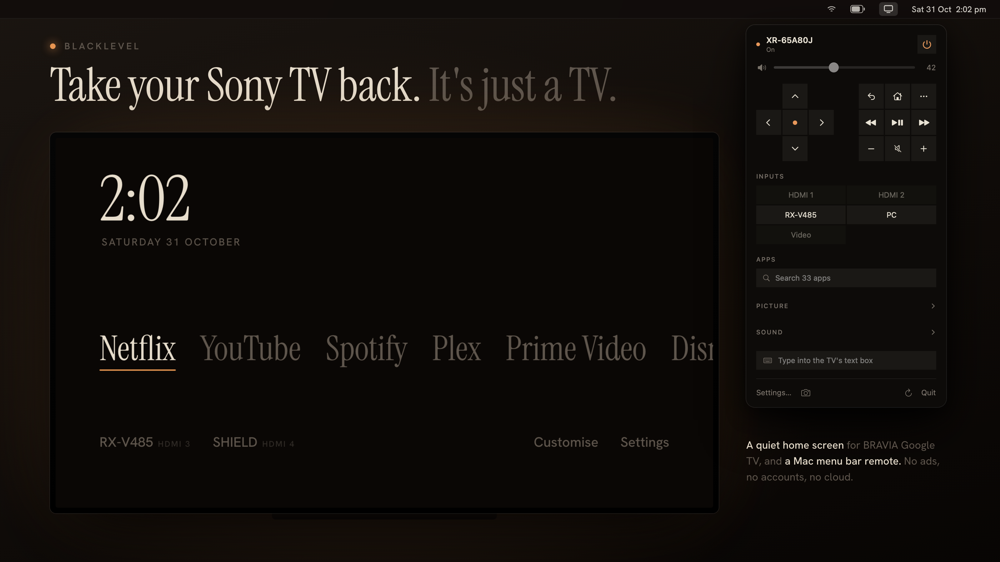

# Blacklevel

**Take your Sony TV back. It's just a TV.**

Blacklevel replaces the busy parts of a Sony BRAVIA Google TV with quiet ones: a dark, typographic home screen with no ads or recommendation rows, and a native macOS menu bar remote. No accounts, no cloud, no third-party code. Everything talks to the TV over your local network.

  

## What's in the box

| | Runs on | What it is |
|---|---|---|
| **[Blacklevel Home](launcher/)** | The TV (Android TV / Google TV) | A replacement home screen. The time, one row of your apps, one row of your HDMI inputs, and Settings. Nothing else. Built for OLED: dark, dims when idle, drifts to avoid burn-in. ~128 KB. |
| **[Blacklevel Remote](menubar/)** | macOS 14+ | A SwiftUI menu bar remote: power, volume, inputs, apps, D-pad, playback, picture and sound settings, text entry, screenshots. Uses Sony's BRAVIA REST API and IRCC codes. |

  

## Quick start

1. **Prepare the TV**: turn on IP control with a pre-shared key, and (for Home) network debugging. See [TV setup](docs/tv-setup.md).
2. **Remote**: `cd menubar && ./build.sh && open build/BlacklevelRemote.app`, then enter the TV's address and key in **Settings…**. [More](menubar/README.md)
3. **Home**: `cd launcher && ./build.sh`, then install and set it as the home screen with `adb`. [More](launcher/README.md)

Both parts are independent. Use either, or both.

## Compatibility

Developed and tested on a **Sony XR-65A80J** (2021, Google TV). It should work on other BRAVIA TVs that expose the BRAVIA REST API ("IP control"), which covers most Sony Android TV and Google TV models from 2015 onward. The remote reads the TV's supported methods, inputs, apps and remote keys at runtime, so it only shows what your TV can do.

If you try it on another model, please open an issue with what worked and what didn't.

## Further intentions

Ideas, not promises. The rule stays the same: local network only, no accounts, no cloud, no third-party code.

Next up:

- **Signed and notarised remote**: sign Blacklevel Remote with a Developer ID and notarise it, so macOS opens it without the right-click workaround.
- **Re-order apps on the home screen**: choose the order of the apps row on Blacklevel Home, instead of it following recent use.

Later:

- **Mobile remote**: an iPhone (and maybe Android) app with the same features as the menu bar remote, built on the same BRAVIA REST API and IRCC calls. A phone remote that does only what the TV needs, without the vendor app's sign-in and suggestions.
- **Windows tray remote**: the menu bar remote for Windows, living in the system tray. Same feature set, same "reads what your TV supports at runtime" approach.
- **Shared API layer**: as more clients appear, write down the BRAVIA calls each one depends on (methods, IRCC codes, quirks per model) so every client behaves the same way.
- **Wider model testing**: confirm behaviour beyond the XR-65A80J and note the differences in [Compatibility](#compatibility).

If one of these matters to you, open an issue and say so.

## Working with coding agents

This repo is small and dependency-free on purpose, which makes it easy to hand to a coding agent (Claude Code, Codex, Cursor and the like). Point the agent at this section, then at the README for the part it's changing.

**Orientation**

- `launcher/`: Blacklevel Home. Kotlin `HomeActivity.kt` hosts a WebView; the whole UI is `app/assets/index.html`. Built by `build.sh` with `kotlinc`, `d8` and `aapt2`; no Gradle. Design intent lives in `launcher/.impeccable.md`; read it before touching the UI.
- `menubar/`: Blacklevel Remote. A Swift package: `BraviaClient.swift` (REST + IRCC), `TVStore.swift` (state), `Views.swift` (SwiftUI), `Support.swift` (keychain, helpers), `SelfTest.swift`. Built by `build.sh`; no Xcode project.
- `docs/`: user-facing setup and troubleshooting. `docs/images/` holds the screenshots used in READMEs.
- `screensaver/` is git-ignored (Sony's artwork, personal use only). Never commit it or copy from it into tracked files.

**Ground rules**

- No new dependencies, package managers, build systems or network services. Everything talks to the TV on the LAN.
- Keep the launcher OLED-safe: dark backgrounds, no large static bright areas, keep the idle dimming and drift. D-pad navigation must keep working.
- Don't hard-code a model's capabilities. Ask the TV (supported methods, inputs, apps, remote keys) and hide what it doesn't support.
- Never commit secrets: the pre-shared key lives in the macOS keychain, `*.keystore` is ignored, and TV IPs belong in settings, not source.
- Match the surrounding code's style and comment density. Small, focused changes.

**Checking your work**

- Remote: `cd menubar && ./build.sh`, then `build/BlacklevelRemote.app/Contents/MacOS/BlacklevelRemote --selftest` to run every API call against a real TV (non-disruptive), and `--snapshot menu.png` to render the menu to an image for visual review.
- Home: `cd launcher && ./build.sh`, install with `adb`, and check it on the TV with a D-pad. `index.html` can also be opened in a desktop browser for layout work.
- If a change alters what the user sees, update the matching screenshot in `docs/images/` and the README that describes it.

## Documentation

- [TV setup](docs/tv-setup.md): IP control, pre-shared key, remote start, network debugging
- [Blacklevel Home](launcher/README.md): build, install, customise, revert
- [Blacklevel Remote](menubar/README.md): build, run, feature list
- [Troubleshooting](docs/troubleshooting.md)

## Building from source

No Gradle, no Xcode project, no dependencies to fetch.

- **Home** needs `openjdk@17`, `kotlin`, and Android SDK `platforms;android-34` + `build-tools;34.0.0`.
- **Remote** needs Swift 5.9+ (Xcode Command Line Tools) on macOS 14 or later.

## License

[MIT](LICENSE). The bundled fonts (Hanken Grotesk, Instrument Serif) are under the [SIL Open Font License](launcher/app/assets/fonts/OFL.txt).

Blacklevel is an independent project and is not affiliated with, endorsed by, or sponsored by Sony Group Corporation or Google LLC. Sony and BRAVIA are trademarks of Sony Group Corporation. Google TV and Android TV are trademarks of Google LLC.
