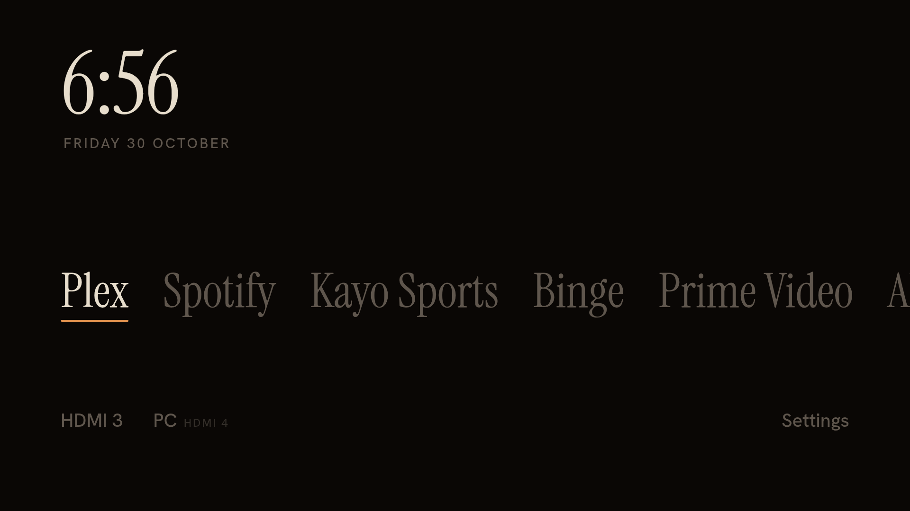
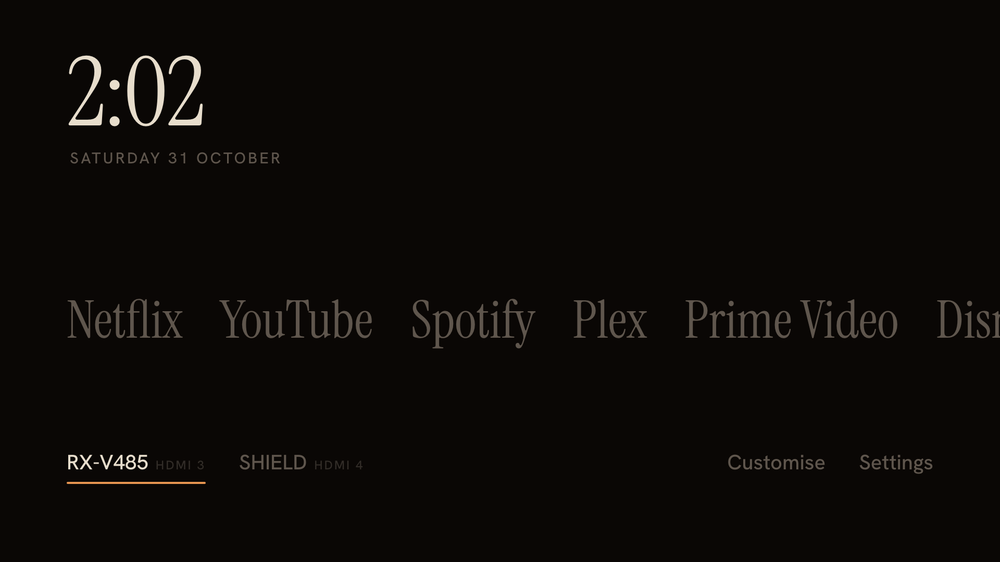

# Blacklevel Home

A replacement home screen for Sony BRAVIA Google TV / Android TV. The time, one row of your apps, one row of your HDMI inputs, and Settings. Nothing else.




- **Apps** come from the TV itself (every app with a TV launcher entry), minus the bundled Sony and Google extras (Play Store, Sony Select, the Vewd browser and so on). YouTube stays. By default the app you opened last moves to the front; hold OK on an app to pick it up, ◀ ▶ to move it, OK to place it (Back cancels). Placing one switches **Customise → Apps → Order** to *Your order*; switch it back to *Recently opened* any time.
- **Names, icons or tiles**: **Customise → Apps → Show as** picks the row of app names, *Icons*, a close-set strip of each app's own icon with the focused app's name above it, or *Tiles*, the icons as rounded squares with each app's name in small capitals beneath and the focused one lifted (no name above; the vertical layout shows tiles as its icon column). **Customise → Icons** sets the icons' **Shape** (square, rounded or circle; apps with an older-style icon keep their own) and whether the icons you're not on fade to grey (**Fade others**).
- **Inputs** are the connected HDMI ports, named after the HDMI-CEC device on them ("SHIELD", "RX-V485") or the name you gave the port on the TV ("PC"). Device names come from the TV's own local Sony API, which needs no key. That API takes about a second to answer, so names are cached and the row updates when they change.
- **Now playing**: whatever's playing in the background (Spotify, Plex, YouTube…) shows across from the clock: the cover, title, artist and a line that runs along with the song. Paused, it goes grey; stopped, it's gone. It reads the standard Android media session, which Android only shares with an app you've enabled as a notification listener, so it needs the `allow_listener` line in [Install](#install) once. Covers an app only gives as a web address are left out, so Home still makes no requests outside your network but the update check. Turn it off with **Customise → Screen → Now playing**.
- **Atmosphere**: the room behind the home screen takes on a soft light from the app you're on, and the line under it takes the app's colour: amber for Netflix, red for YouTube, green for Spotify, gold for Plex, blue for Prime Video, violet for Disney+. Any other app borrows its colour from its own icon; one with a grey icon, and the inputs row, get the room's own warm light. The light changes once you stop on an app, so holding ◀ ▶ along the row stays quick. **Customise → Atmosphere** sets the **Light** (*Each app's own*, *Always warm* or *Off*) and its **Strength**.
- **Word clock**: when the home screen's been left alone, it can turn into a word clock instead of dimming: the time to the nearest five minutes in warm lit words on a fixed grid of letters ("IT IS TWENTY FIVE TO SEVEN"), the unlit letters barely there. Words fade across slowly when the time changes, and nothing else moves. Any button brings the home screen back exactly as you left it; that first press does nothing else. Set it up in **Customise → Idle**: **When idle** (*Dim the screen* or *Word clock*), **After** (1, 5 or 15 minutes), **Minute dots** (four small dots under the grid, one per minute past the five; with them on, the words round down instead), **Brightness**, and **Word clock → Show now**. [`app/assets/wordclock.js`](app/assets/wordclock.js) decides what's lit and when; [`WordClock.kt`](app/src/io/github/itsonlyjames/blacklevel/WordClock.kt) draws the letters, at 1080p like the rest of Android. (A 4K surface was sharper, but on the A80J it left the TV's display hardware in a mode that shrank HDMI inputs into the top-left quarter until a reboot.) Idle, keys and settings stay with the page.
- **OLED care**: a dark, warm background; dims to ~30% (or shows the word clock) after a minute idle; shifts everything a few pixels every minute.
- **Remote**: ◀ ▶ move along a row, ▲ ▼ switch rows, OK opens, hold OK moves an app. In Customise, ▲ ▼ pick a section and ▶ goes into its settings, where ◀ ▶ change them. Back steps back out of Customise or cancels a move, and otherwise does nothing (you're already home).

It's a single `WebView` page ([`app/assets/index.html`](app/assets/index.html)) with a small Kotlin bridge ([`HomeActivity.kt`](app/src/io/github/itsonlyjames/blacklevel/HomeActivity.kt)) that lists apps and inputs. The APK is about 150 KB. Fonts are bundled, so it works offline.

## Build

Requires `openjdk@17`, `kotlin`, and the Android SDK packages `platforms;android-34` and `build-tools;34.0.0` (in `~/Library/Android/sdk`, or set `ANDROID_HOME`).

```bash
brew install openjdk@17 kotlin
./build.sh
```

The script runs aapt2 → kotlinc → R8 → zipalign → apksigner directly, no Gradle. Output: `build/home.apk`. The first build creates a local `debug.keystore` to sign with; keep it, since reinstalling over an APK signed with a different key fails. The keystore that signs the published releases is the only key in-app updates will accept, so back it up somewhere other than this Mac: lose it and every TV has to uninstall Blacklevel Home to move to a new key.

## Install

Set up network debugging first ([TV setup](../docs/tv-setup.md#3-network-debugging-for-blacklevel-home-optional-for-the-remote)).

```bash
adb connect <tv-ip>:5555
adb install -r build/home.apk
adb shell cmd package set-home-activity io.github.itsonlyjames.blacklevel/.HomeActivity
adb shell appops set --user 0 io.github.itsonlyjames.blacklevel REQUEST_INSTALL_PACKAGES allow   # lets it update itself
adb shell cmd notification allow_listener io.github.itsonlyjames.blacklevel/io.github.itsonlyjames.blacklevel.NowPlayingListener   # lets it see what's playing
```

On a Sony A80J (Google TV, Android 12) that isn't enough by itself. `set-home-activity` and the HOME role both report success, but the Home button still opens Google TV's launcher. With that launcher disabled, Home goes to Google's setup app (`com.google.android.tungsten.setupwraith/.RecoveryActivity`), which shows nothing. adb isn't allowed to disable that one activity (`Shell cannot change component state`), so the whole setup app has to be disabled:

```bash
adb shell pm disable-user --user 0 com.google.android.tungsten.setupwraith
adb shell pm disable-user --user 0 com.google.android.apps.tv.launcherx
adb shell cmd package set-home-activity --user 0 io.github.itsonlyjames.blacklevel/.HomeActivity
adb shell cmd role add-role-holder --user 0 android.app.role.HOME io.github.itsonlyjames.blacklevel
```

Verified on the A80J on 30 October 2026 with the earlier build (package `tv.hijacking.home`). Home opened Blacklevel Home from YouTube, Plex, Netflix, TV Settings and the SHIELD input. It still did after a minute and after a reboot (the TV boots to its last input, as normal; Home then opens Blacklevel Home). Back on the home screen stays put. Opening apps, inputs and Settings from it all worked.

### Current state of the TV

| Package | State |
|---|---|
| `com.google.android.apps.tv.launcherx` (Google TV home) | disabled |
| `com.google.android.tungsten.setupwraith` (Google TV setup and recovery) | disabled |
| `tv.samba.ssm` (Samba TV) | disabled (separately, for privacy) |
| `com.sony.dtv.homekit`, `com.sonypicturescore`, `com.apple.atve.sony.appletv`, `com.sony.dtv.kenhchonloc`, `com.sony.dtv.b2b.softap` | disabled from the factory; leave them |
| `io.github.itsonlyjames.blacklevel` (Blacklevel Home) | installed 31 October 2026; home screen and HOME role holder |
| `tv.hijacking.home` (Blacklevel Home, earlier package name) | removed |

### After every Blacklevel Home install or update

Reinstalling can clear the home choice, so run this again after each install. With Google's launcher and setup app disabled, Blacklevel Home is also the only real home left, so Android should pick it anyway:

```bash
adb shell cmd package set-home-activity --user 0 io.github.itsonlyjames.blacklevel/.HomeActivity
adb shell cmd role add-role-holder --user 0 android.app.role.HOME io.github.itsonlyjames.blacklevel
```

Builds before 31 October 2026 used the package `tv.hijacking.home`, which Android treats as a different app. If you have it, install the new build, run the two commands above, press Home to check it opens, then remove the old one with `adb uninstall tv.hijacking.home`. The new build starts with an empty recent-apps order.

## Updates

Once a day Blacklevel Home asks GitHub for the latest release. When there's a newer one, **Customise** on the home screen says *Update available*. Open it (it opens on its **Updates** section), go to the **Update** row and press OK: it downloads the APK, checks it against `SHA256SUMS.txt` and hands it to Android, which asks you to confirm. Press ◀ then OK on **Update** (the dialog starts on Cancel). Turn the daily check off with **Customise → Updates → Updates**; on the **Version** row, OK checks now. This is the only request Blacklevel Home makes outside your network.

Android only lets an app install updates once you've allowed it, which is what the `appops` line in [Install](#install) does. Without it, pressing OK opens the TV's **Install unknown apps** list. On the A80J that list doesn't help: `adb install` puts the app in both of the TV's users (0 and Sony's second profile, 10), and the toggle there allows the user-10 copy, not the one you see. Run the `appops` line instead.

Only builds signed with the release key can update this way, so a copy you built yourself says to update with adb. Verified on the A80J on 31 October 2026 (1.0.9 test build → 1.1.0): the confirmation appeared, the update installed, and Home still opened Blacklevel Home with the HOME role kept. After an app has installed itself once, Android 12 may skip the confirmation for later updates; that part hasn't been seen yet.

## Before a factory reset or a major Google TV update

Switch Google's apps back on first. The setup app runs first-time setup and recovery, so a reset or big update may misbehave without it:

```bash
adb shell pm enable com.google.android.tungsten.setupwraith
adb shell pm enable com.google.android.apps.tv.launcherx
```

Afterwards, disable them again with the install commands above if you still want Blacklevel Home.

## Revert to the stock home screen

The launcher lines were verified on the A80J: they restored Google TV after an earlier attempt that disabled only the launcher. Re-enabling the whole setup app hasn't been run yet, but it's the same `pm enable` that undoes `disable-user`.

```bash
adb shell pm enable com.google.android.tungsten.setupwraith
adb shell pm enable com.google.android.apps.tv.launcherx
adb shell cmd package set-home-activity --user 0 com.google.android.apps.tv.launcherx/.home.HomeActivity
adb shell cmd role add-role-holder --user 0 android.app.role.HOME com.google.android.apps.tv.launcherx
adb uninstall io.github.itsonlyjames.blacklevel
adb uninstall tv.hijacking.home                      # only if a pre-rename build is still installed
```

Then press Home to check it opens Google TV.

## Customise

- **Design**: open `app/assets/index.html` in a desktop browser. Without the Android bridge it uses mock data, so you can iterate without a TV. The page is laid out at 1920×1080.
- **Starting app order**: the `preferred` list in `HomeActivity.kt`. It only matters until you've opened a few apps; after that the most-recently-opened order takes over.
- **Hidden apps**: the `hidden()` function in `HomeActivity.kt`.

`design/` has the mockup iterations (v1–v4) and photos from the TV.
