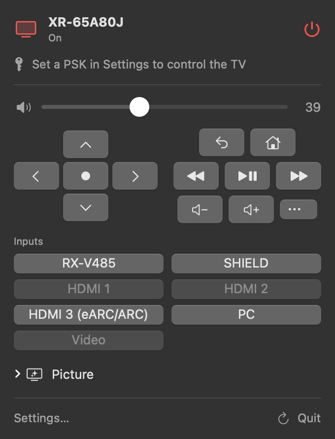

# Blacklevel Remote

A native SwiftUI menu bar remote for Sony BRAVIA TVs. It uses Sony's BRAVIA REST API and IRCC remote codes, with no third-party code.



## Install

Download `BlacklevelRemote-<version>-macOS.zip` from [Releases](https://github.com/itsonlyjames/blacklevel/releases/latest), unzip it and move **BlacklevelRemote.app** to Applications. It's signed and notarised, so it opens like any other app. Needs macOS 14 or later; runs on Apple silicon and Intel.

## Build and run

To build it yourself instead, you need macOS 14+ and Swift 5.9+ (`xcode-select --install`). `build.sh` signs with your Developer ID if one is in your keychain, and ad hoc otherwise.

```bash
./build.sh
open build/BlacklevelRemote.app
```

A TV icon appears in the menu bar (filled when the TV is on). The first time it talks to the TV, macOS asks for Local Network access. Allow it.

Then open **Settings…**:

1. On first launch the remote searches the network and picks the first TV it finds. To choose another, enter its address or click **Find**.
2. Enter the TV's pre-shared key ([how to set one](../docs/tv-setup.md#2-ip-control-and-pre-shared-key-for-blacklevel-remote)), then **Save Key** and **Test Connection**.
3. Click **Detect** next to the MAC address so the remote can wake the TV from standby.

To start it at login, add the app under **System Settings → General → Login Items**.

The key is stored in your login keychain. The TV's address and MAC address are kept in the app's preferences.

## Updates

Once a day the remote asks GitHub for the latest release. When there's a newer one, the menu shows **Version x.y.z is available** with an **Update** button. It downloads the release, checks it against `SHA256SUMS.txt` and checks it's signed by the same Developer ID, then swaps it in and reopens. Turn the check off, or check now, under **Settings… → Updates**. This is the only request the remote makes outside your network.

Keep the app in Applications: macOS runs apps opened straight from Downloads from a temporary copy, which can't replace itself. A build you made yourself isn't signed with the release's Developer ID, so **Update** opens the release page instead.

## What it does

| Feature | API | Needs key |
|---|---|---|
| Power status, model | `system.getPowerStatus`, `getInterfaceInformation` | No |
| Volume level and mute state | `audio.getVolumeInformation` | No |
| Input list (HDMI, CEC devices) | `avContent.getCurrentExternalInputsStatus` | No |
| Picture settings (read) | `video.getPictureQualitySettings` | No |
| Remote key list | `system.getRemoteControllerInfo` | No |
| Find the TV | SSDP search for `ScalarWebAPI` | No |
| Power on/off | `system.setPowerStatus` and Wake-on-LAN | Yes (WoL doesn't) |
| Set volume, mute | `audio.setAudioVolume`, `setAudioMute` | Yes |
| Switch input | `avContent.setPlayContent` | Yes |
| Launch an app | `appControl.getApplicationList`, `setActiveApp` | Yes |
| Change picture and sound settings | `video.setPictureQualitySettings`, `audio.setSpeakerSettings` | Yes |
| Now playing | `avContent.getPlayingContentInfo` | Yes |
| D-pad, Home, Back, playback, every other remote key | IRCC SOAP at `/sony/IRCC` | Yes |
| Type into the TV's text box | `appControl.setTextForm` | Yes |
| Screenshot to Pictures | `system.getScreenshot`, or ADB | Yes (ADB doesn't) |

The remote reads the method list, inputs, apps, picture settings and remote keys from the TV at runtime, so it only shows what your TV supports.

**No key yet?** If `adb` is installed and network debugging is on, the D-pad sends keys with `adb shell input keyevent` instead. You can turn this off in Settings.

## Testing

```bash
build/BlacklevelRemote.app/Contents/MacOS/BlacklevelRemote --selftest           # run every API call against the TV, print results
build/BlacklevelRemote.app/Contents/MacOS/BlacklevelRemote --snapshot menu.png  # render the live menu to a PNG and quit
build/BlacklevelRemote.app/Contents/MacOS/BlacklevelRemote --update             # install a newer release over this copy, if there is one
```

To try the updater, copy the app somewhere, set its `CFBundleShortVersionString` below the latest release, sign it again with your Developer ID and run it with `--update`.

## Source

| File | What |
|---|---|
| `BraviaClient.swift` | JSON-RPC, IRCC and Wake-on-LAN transport |
| `TVStore.swift` | State, polling and every TV action |
| `Views.swift` | The menu and Settings window |
| `Support.swift` | Keychain, SSDP discovery, MAC lookup, ADB fallback |
| `Updater.swift` | Checks GitHub Releases and installs a newer version |
| `SelfTest.swift` | `--selftest` |
